<picture>
  <source media="(prefers-color-scheme: dark)" srcset="assets/hero-dark.svg">
  
</picture>

 

  

## About

I'm a full-stack developer and software engineer with 2+ years of experience building web applications end to end. I work across the frontend, backend, and database, with a focus on TypeScript, clear system boundaries, and maintainable code.

I care about shipping useful software: clear interfaces, reliable APIs, and code that is easy for the next person to work with.

## Stack

  <picture>
    <source media="(prefers-color-scheme: dark)" srcset="https://skillicons.dev/icons?i=ts%2Cjs%2Creact%2Cnextjs%2Cnodejs%2Cnestjs%2Cpostgres%2Cdocker%2Cgithubactions%2Cpython&perline=10&theme=dark">
    
  </picture>

  TypeScript · JavaScript · React · Next.js · Node.js · NestJS · PostgreSQL · SQL · Docker · GitHub Actions · Python

## Focus

- **Full-stack delivery** — React and Next.js frontends; Node.js and NestJS backends.
- **Data and APIs** — PostgreSQL, SQL, and well-structured API design.
- **Developer experience** — TypeScript, Docker, GitHub Actions, and maintainable codebases.

## Currently

  

I'm going deeper into AI/LLM engineering — focusing on retrieval, evaluation, and the practical work of shipping reliable AI features.

## GitHub Snapshot

  <picture>
    <source media="(prefers-color-scheme: dark)" srcset="https://github-profile-summary-cards.vercel.app/api/cards/profile-details?username=Gen-2k&theme=tokyonight">
    
  </picture>

  Public GitHub activity only. Private work is not included.

## Connect

  <strong>Let's build something useful.</strong>

  
  

<!--
Portfolio, LinkedIn, and email can be added here when ready.

-->

  

  Full-stack developer · TypeScript · React · Node.js · PostgreSQL

<!--
## Experience

### Software Engineer · Company · Dates
- Add a measurable responsibility or achievement.
- Add a measurable responsibility or achievement.
-->

<!--
## Selected achievements

Keep this section only when you have concrete, verifiable results.

- Reduced ... by ...%.
- Built ... used by ... people.
- Led ... across ... .
-->
